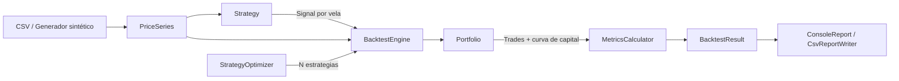

# Trading Bot Simulator


[](https://github.com/cawtterminal/trading-bot-simulator/actions/workflows/ci.yml)

Motor de **backtesting** y librería de **indicadores técnicos** escrita en Java puro, sin dependencias externas en runtime. Permite simular estrategias de trading algorítmico sobre datos históricos (OHLCV), modelando costos reales de ejecución y evaluando los resultados con métricas profesionales de riesgo/retorno.

> Proyecto educativo. No constituye asesoramiento financiero.

---

## Tabla de contenidos

- [Características](#características)
- [Demo](#demo)
- [Arquitectura](#arquitectura)
- [Modelo de ejecución](#modelo-de-ejecución)
- [Indicadores](#indicadores)
- [Estrategias](#estrategias)
- [Métricas](#métricas)
- [Instalación y uso](#instalación-y-uso)
- [Usar datos reales](#usar-datos-reales)
- [Tests](#tests)
- [Decisiones de diseño](#decisiones-de-diseño)
- [Roadmap](#roadmap)

---

## Características

- **6 indicadores técnicos** implementados desde cero: SMA, EMA, RSI (Wilder), MACD, Bandas de Bollinger y ATR.
- **6 estrategias** listas para usar, incluida una compuesta mediante el patrón *Decorator* (filtro de tendencia).
- **Motor de backtesting sin sesgo de anticipación** (*look-ahead bias*): las señales se generan con el cierre de la vela `t` y se ejecutan en la apertura de `t+1`.
- **Costos realistas**: comisión por operación, *slippage*, tamaño de posición configurable, *stop loss* y *take profit* intradía con manejo de *gaps*.
- **15+ métricas de performance**: CAGR, Sharpe, Sortino, Calmar, Max Drawdown, Profit Factor, Win Rate, exposición y comparación contra Buy & Hold.
- **Optimizador con validación walk-forward**: búsqueda en grilla de parámetros sobre el 70 % de los datos y validación sobre el 30 % restante, para detectar sobreajuste.
- **Generador de mercado sintético** (movimiento browniano geométrico con cambios de régimen) reproducible por semilla.
- **Reportes** en consola (tablas + curva de capital en ASCII) y exportación a CSV.
- **61 tests unitarios** con JUnit 5 y pipeline de CI en GitHub Actions.

---

## Demo

### Comparación de estrategias

```
$ java -jar target/trading-bot-simulator.jar --data data/sample_prices.csv --symbol SIM --compare

============================================================================================
  Strategy comparison  |  SIM  |  2021-01-04 -> 2024-11-01
============================================================================================
  Strategy                                  Return      CAGR    Max DD  Sharpe Sortino Trades Win rate     PF
  ------------------------------------------------------------------------------------------
  SMA Cross (20/50)                        -17.17%    -4.64%   -39.09%   -0.19   -0.27     10   30.00%   0.55
  EMA Cross (12/26)                        +17.55%    +4.16%   -30.55%    0.31    0.45     12   41.67%   1.38
  RSI(14) 30/70                            -28.13%    -7.99%   -49.29%   -0.37   -0.51      3   66.67%   0.10
  MACD(12,26,9)                            -10.02%    -2.63%   -42.74%   -0.03   -0.04     38   36.84%   0.88
  Bollinger Reversion BB(20,2.0)           -37.76%   -11.26%   -50.39%   -0.77   -1.02     15   53.33%   0.30
  RSI(14) 40/70 + Trend(100)               -33.65%    -9.82%   -61.20%   -0.38   -0.53      3   66.67%   0.28
  ------------------------------------------------------------------------------------------
  Buy & Hold (benchmark)                   -17.81%
============================================================================================
```

### Backtest individual con stop loss y take profit

```
$ java -jar target/trading-bot-simulator.jar --data data/sample_prices.csv --symbol SIM \
      --strategy ema-cross --stop-loss 0.06 --take-profit 0.2 --output reports

  Last 10 of 12 trades
  Entry        Exit            Entry px     Exit px      Net P&L    Return  Exit reason
  ------------------------------------------------------------------------------------------
  2021-09-14   2022-01-28        127.60      153.05    $1,958.37   +19.72%  TAKE_PROFIT
  2022-03-25   2022-04-06        140.14      131.67     -$741.88    -6.24%  STOP_LOSS
  2022-06-22   2022-08-08        121.72      145.99    $2,198.03   +19.72%  TAKE_PROFIT
  ...
```

### Optimización walk-forward

El modo `--optimize` muestra un caso real de **sobreajuste**: la mejor combinación en el período de entrenamiento (`SMA 15/100`, Sharpe 0.38) termina perdiendo en el período de validación, mientras el mercado subía. Por eso el proyecto valida siempre fuera de muestra.

```
  In-sample ranking by sharpe (34 combinations, first 70% of data)
  SMA Cross (15/100)                       +13.78%    +4.76%   -18.00%    0.38    0.55      3   66.67%   8.66
  ...
  Out-of-sample validation of the best combination
  Total return       -3.99%                 Buy & Hold         +3.35%
```

---

## Arquitectura

```
src/main/java/com/tradingbot
├── TradingBotApplication.java     Punto de entrada y orquestación de modos
├── cli/                           Parseo y validación de argumentos
├── model/                         Dominio inmutable: Candle, PriceSeries, Trade, Signal...
├── data/                          Carga/escritura CSV y generador de mercado sintético
├── indicator/                     Indicadores técnicos (interfaz genérica Indicator<T>)
├── strategy/                      Estrategias, decorador de tendencia y factory
├── engine/                        Motor de backtesting, portfolio y configuración
├── metrics/                       Cálculo de métricas de riesgo y retorno
├── optimization/                  Grid search y validación walk-forward
└── report/                        Reportes de consola, gráfico ASCII y exportación CSV
```



Cada capa depende solo de las de abajo: los indicadores no conocen a las estrategias, las estrategias no conocen al motor, y el motor no sabe cómo se reportan los resultados.

---

## Modelo de ejecución

| Aspecto | Comportamiento |
|---|---|
| Momento de la señal | Al cierre de la vela `t`, usando solo información disponible hasta ese momento |
| Ejecución | Apertura de la vela `t+1` |
| Comisión | Porcentaje sobre el nominal, cobrado en la entrada y en la salida |
| Slippage | Empeora el precio de cada fill (compra más cara, venta más barata) |
| Stop loss | Se evalúa contra el mínimo de cada vela; si el precio abre por debajo del stop (*gap*), se ejecuta en la apertura |
| Take profit | Se evalúa contra el máximo de cada vela, con la misma lógica de *gaps* |
| Prioridad | Si una vela toca stop y target, se asume el stop (criterio conservador) |
| Fin de datos | Las posiciones abiertas se cierran al último cierre |
| Dirección | Solo posiciones largas (*long-only*) |

---

## Indicadores

| Indicador | Clase | Detalle |
|---|---|---|
| Media Móvil Simple | `SimpleMovingAverage` | Ventana deslizante O(n) |
| Media Móvil Exponencial | `ExponentialMovingAverage` | Semilla con SMA, α = 2 / (n + 1) |
| RSI | `RelativeStrengthIndex` | Suavizado de Wilder |
| MACD | `Macd` | Línea MACD, señal e histograma |
| Bandas de Bollinger | `BollingerBands` | Media ± k · desvío estándar poblacional |
| ATR | `AverageTrueRange` | True Range con *gaps* y suavizado de Wilder |

Todos devuelven series del mismo largo que la entrada, con `NaN` durante el período de calentamiento, y pueden encadenarse (el MACD calcula una EMA sobre otra serie con `NaN` iniciales).

```java
PriceSeries series = CsvCandleLoader.load(Path.of("data/sample_prices.csv"), "SIM");

double[] rsi = new RelativeStrengthIndex(14).calculate(series);
Macd.Result macd = new Macd(12, 26, 9).calculate(series);
BollingerBands.Result bands = new BollingerBands(20, 2.0).calculate(series);
```

---

## Estrategias

| ID | Estrategia | Compra | Vende |
|---|---|---|---|
| `sma-cross` | Cruce de SMA 20/50 | Media rápida cruza hacia arriba la lenta | Cruce hacia abajo |
| `ema-cross` | Cruce de EMA 12/26 | Ídem con medias exponenciales | Ídem |
| `rsi` | RSI 30/70 | RSI sale de sobreventa (cruza 30 hacia arriba) | RSI entra en sobrecompra (cruza 70) |
| `macd` | MACD 12/26/9 | MACD cruza la señal hacia arriba | MACD cruza la señal hacia abajo |
| `bollinger` | Reversión a la media | El precio vuelve a entrar por la banda inferior | El precio cruza la media |
| `rsi-trend` | RSI 40/70 + filtro de tendencia | Señal RSI solo si el precio está sobre la SMA 100 | Señal RSI |

Crear una estrategia nueva es implementar una sola interfaz:

```java
public interface Strategy {
    String name();
    Signal[] generateSignals(PriceSeries series);
}
```

---

## Métricas

| Métrica | Descripción |
|---|---|
| Total return | Retorno total sobre el capital inicial |
| CAGR | Retorno anualizado compuesto (252 ruedas por año) |
| Volatility | Desvío estándar anualizado de los retornos diarios |
| Max drawdown | Mayor caída desde un máximo previo de la curva de capital |
| Sharpe ratio | Retorno en exceso / volatilidad, anualizado |
| Sortino ratio | Como Sharpe, pero penaliza solo la volatilidad negativa |
| Calmar ratio | CAGR / Max drawdown |
| Win rate | Porcentaje de operaciones ganadoras |
| Profit factor | Ganancias brutas / pérdidas brutas |
| Exposure | Porcentaje del tiempo con posición abierta |
| Alpha vs B&H | Diferencia de retorno contra comprar y mantener |

---

## Instalación y uso

### Requisitos

- Java 21+
- Maven 3.9+

### Compilar

```bash
git clone https://github.com/TU_USUARIO/trading-bot-simulator.git
cd trading-bot-simulator
mvn clean package
```

### Ejemplos

```bash
# Backtest de una estrategia sobre los datos de ejemplo
java -jar target/trading-bot-simulator.jar --data data/sample_prices.csv --strategy macd

# Comparar todas las estrategias
java -jar target/trading-bot-simulator.jar --data data/sample_prices.csv --compare

# Gestión de riesgo: 50 % del capital por operación, stop 5 %, target 15 %
java -jar target/trading-bot-simulator.jar --data data/sample_prices.csv --strategy ema-cross \
    --position-size 0.5 --stop-loss 0.05 --take-profit 0.15

# Optimizar parámetros y validar fuera de muestra
java -jar target/trading-bot-simulator.jar --data data/sample_prices.csv --optimize --rank-by sortino

# Mercado sintético con otra semilla y exportar resultados a CSV
java -jar target/trading-bot-simulator.jar --days 1500 --seed 7 --strategy rsi --output reports
```

### Opciones

| Opción | Descripción | Default |
|---|---|---|
| `--data <archivo>` | CSV con columnas `Date,Open,High,Low,Close[,Volume]` | datos sintéticos |
| `--symbol <nombre>` | Símbolo que aparece en los reportes | nombre del archivo |
| `--strategy <id>` | Estrategia a ejecutar | `sma-cross` |
| `--compare` | Ejecuta todas las estrategias | — |
| `--optimize` | Grid search + walk-forward 70/30 | — |
| `--rank-by <métrica>` | `sharpe`, `sortino`, `calmar`, `total-return` | `sharpe` |
| `--capital <monto>` | Capital inicial | `10000` |
| `--commission <tasa>` | Comisión por lado (`0.001` = 0.1 %) | `0.001` |
| `--slippage <tasa>` | Slippage por ejecución | `0.0005` |
| `--position-size <fracción>` | Porción del efectivo por operación | `1.0` |
| `--stop-loss <fracción>` | Stop loss desde el precio de entrada | desactivado |
| `--take-profit <fracción>` | Take profit desde el precio de entrada | desactivado |
| `--days <n>` / `--seed <n>` | Largo y semilla del mercado sintético | `1000` / `42` |
| `--output <dir>` | Exporta operaciones y curva de capital en CSV | — |
| `--export-data <archivo>` | Guarda la serie de precios usada | — |

---

## Usar datos reales

El archivo `data/sample_prices.csv` es **sintético** (generado con `--seed 42`). Para usar datos reales alcanza con cualquier CSV con este formato, por ejemplo el que exporta Yahoo Finance desde la pestaña *Historical Data*:

```csv
Date,Open,High,Low,Close,Volume
2024-01-02,187.15,188.44,183.89,185.64,82488700
2024-01-03,184.22,185.88,183.43,184.25,58414500
```

```bash
java -jar target/trading-bot-simulator.jar --data AAPL.csv --compare
```

El cargador acepta columnas en cualquier orden y mayúsculas/minúsculas, ignora columnas extra (como `Adj Close`), ordena por fecha y valida la consistencia de cada vela.

---

## Tests

```bash
mvn test
```

La suite cubre:

- **Indicadores**: valores calculados a mano (incluido el suavizado de Wilder del RSI), períodos de calentamiento y casos borde.
- **Motor**: ejecución en la apertura siguiente, comisiones, slippage, tamaño de posición, stop loss con y sin *gap*, take profit y cierre al final de los datos.
- **Métricas**: drawdown, CAGR, Sharpe/Sortino y estadísticas de operaciones.
- **Datos**: parseo de CSV, validaciones, ida y vuelta escritura/lectura y determinismo del generador.
- **Optimizador y CLI**: orden del ranking, separación train/test y validación de argumentos.

---

## Decisiones de diseño

- **Dominio inmutable**: `Candle`, `Trade`, `BacktestConfig` y los resultados son `record`s; `PriceSeries` hace copia defensiva y valida el orden cronológico.
- **Estrategias sin estado**: reciben la serie completa y devuelven un arreglo de señales. Eso las hace fáciles de testear y permite que el optimizador las ejecute en paralelo (`parallelStream`) sin condiciones de carrera.
- **Separación señal / ejecución**: la estrategia decide *qué* hacer; el motor decide *cómo y a qué precio*. Así el sesgo de anticipación queda resuelto en un único lugar.
- **Patrones**: *Strategy* (estrategias intercambiables), *Decorator* (`TrendFilteredStrategy`), *Factory* (`StrategyFactory`) y métodos `with...` sobre records inmutables para la configuración.
- **Cero dependencias en runtime**: solo la JDK. JUnit se usa únicamente en tests.
- **Reproducibilidad**: el generador sintético es determinístico por semilla y los reportes usan `Locale.US` para que la salida no dependa de la configuración regional.

---

## Roadmap

- [ ] Posiciones cortas
- [ ] Stop loss dinámico basado en ATR (*trailing stop*)
- [ ] Gestión de múltiples activos en un mismo portfolio
- [ ] Walk-forward con ventanas móviles (*rolling*)
- [ ] Simulación Monte Carlo sobre la secuencia de operaciones
- [ ] Descarga de datos desde una API pública
- [ ] Exportación de reportes en HTML con gráficos

---

## Disclaimer

Este software tiene fines educativos y de demostración técnica. Los resultados de un backtest no garantizan resultados futuros y no constituyen recomendación de inversión.

## Licencia

Distribuido bajo licencia MIT. Ver [LICENSE](LICENSE).
